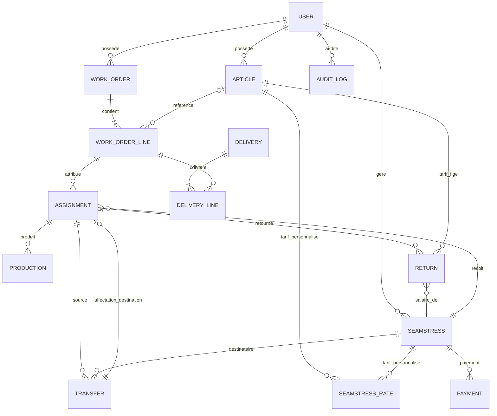

# Soutretance

Application privée de gestion de sous-traitance textile. Le dépôt démarre par le socle backend Django REST Framework et PostgreSQL; le frontend React sera livré dans une phase dédiée.

## Architecture relationnelle



### Flux métier

- `WorkOrder` est le bon Richbond et `WorkOrderLine` conserve un instantané de la référence, du libellé et du tarif par défaut. L'article du catalogue est facultatif pour préserver l'historique même si un article est archivé.
- `Assignment` représente une quantité mise sous la responsabilité d'une couturière. Une allocation issue d'un transfert est référencée comme destination par `Transfer`; l'allocation source n'est jamais réécrite.
- `Production` enregistre les pièces cousues. `Return` est un événement séparé de récupération physique. Le salaire est calculé exclusivement depuis `Return.total_amount`; le tarif unitaire appliqué est figé au moment du retour.
- Le tarif personnalisé `(sous-traitant, article, couturière)` est prioritaire sur le tarif article. Les paiements sont des événements historisés distincts des gains.
- Le stock disponible chez le sous-traitant pour une ligne est `somme des retours - somme des lignes de livraison`. Chaque livraison partielle crée un `Delivery` et des `DeliveryLine`.

### Règles des mouvements

Les services Django atomiques verrouillent la ligne de bon ou l'allocation concernée. L'affectation totale ne peut dépasser le reçu; la production ne peut dépasser l'allocation nette des transferts; le transfert ne peut prendre que le non-cousu encore en possession de la source; le retour ne peut dépasser la production; la livraison ne peut dépasser les retours nets des livraisons précédentes.

Les suppressions physiques de mouvements ne sont pas prévues. Les corrections devront être ajoutées comme opérations correctives auditées. Les validations de cohérence entre propriétaire et clés étrangères sont faites côté service; toutes les vues devront aussi filtrer leurs querysets par `request.user`.

## Structure backend

```text
backend/
  config/                 paramètres, URL, ASGI/WSGI
  apps/accounts/          utilisateur de sous-traitant
  apps/workshop/          catalogue, bons, couturières, mouvements, audit
  apps/finance/           tarifs couturière/article et paiements
```

## Démarrage

```powershell
docker compose up --build
```

API: `http://localhost:8000/api/`; Swagger: `http://localhost:8000/api/docs/`. En développement uniquement, Compose génère les migrations manquantes avant de les appliquer. Il faudra versionner la migration initiale obtenue avant tout déploiement; la génération de migrations ne doit pas faire partie du démarrage en production. Les identifiants PostgreSQL locaux sont destinés au développement et doivent être remplacés en production.

Une fois Python installé localement, les migrations de développement peuvent être créées puis appliquées avec:

```powershell
cd backend
python -m venv .venv
.venv\Scripts\Activate.ps1
pip install -r requirements.txt
python manage.py makemigrations accounts workshop finance
python manage.py migrate
```

## État de cette phase

Le modèle initial et les règles atomiques sont amorcés. La migration initiale sera générée au premier lancement Docker ou via `makemigrations`; les tests métier, les API CRUD et le frontend restent à construire et à valider. Aucun OCR n'est simulé.